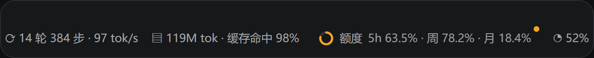

# dsh-usage-plus

[中文](README.zh.md) | English

Independent DSH usage and official Plan-quota plugin (Host + Web UI). It does not pin a DSH version: optional UI surfaces activate only when the running DSH exposes the required capabilities.

[](https://dsh.pub/en/plugins/dsh-usage-plus/)

- Reuses credentials already configured for DSH model providers.
- Shows real 5-hour, weekly, and monthly windows on `conversation.composer.dock` (alongside StatsPills / ContextMeter).
- Labels every Plugins-page number with its scope (`全设备` / `账号级` / `本会话`) so device-wide totals never read as session totals.
- Renders nothing when a provider exposes no official quota window.
- Keeps CPAMC and Volcano Ark as separate sources (Plugins page → Settings).
- Overview includes a full 26-week Mon–Sun activity heatmap (ledger default 182 days).
- Keeps all secrets in the host process / credential vault.
- Shares one conditional-GET poller across the Plugins page and every composer strip; requests never overlap and a hidden tab pauses.
- Serves the overview from a per-revision host cache, so warm polls skip ledger aggregation and answer `304` from a cached ETag.

## Screenshots

### Composer plan strip (current model)



When the active model matches an official plan source, the composer dock shows a compact pill with the real 5-hour / weekly / monthly readings; the ring marks the tightest window. Open it for per-window bars, reset times, and the source chip (for example Volcano). Nothing is rendered when the remote API exposes no official window.

### Plugins → Usage · Overview


The overview reads as one instrument panel: a hero figure for today, the 26-week heatmap as the main chart, account-level quota rings, and a 30-day provider ranking. Every figure is labelled with its scope (`全设备` / `账号级`); the balance line only lists real balances. Plan quotas and external sources live on the other tabs of the same Plugins page.

## Install

Install into a DSH profile with the official plugin command (adds the dependency and appends the package to `dsh.profile.bundles` so `cordis.patch.yml` is applied):

```bash
dsh plugin --profile desktop add github:qxcool/dsh-usage-plus
# or from a local checkout:
# dsh plugin --profile desktop add ./
```

The GitHub form installs the committed `lib/` artifacts in this repository. The npm package may lag behind the GitHub release, so prefer the GitHub form when you want the current version.

The package ships its own bundle patch (`id: usage-plus`, `name: dsh-usage-plus`).
If the older `@linxin666/dsh-usage` / `web-ui-usage` row is also present, disable it
in the profile patch to avoid duplicate UI.

Optional credential names are `CPAMC_MANAGEMENT_KEY`, `VOLC_ACCESSKEY`, and `VOLC_SECRETKEY`. Enable the matching source under **Plugins → Usage Statistics → Settings**, then **Save**. Leaving the page discards an unsaved draft (official `plugins.item` contract).

## Model Experience

- Quota strip follows the **session** `modelSelection` projection (composer picker / `/model`). It does not fall through to another session’s or the global plan while this session already has a route.
- Windows are only shown when the remote Plan API returns real percentages; there is no local token estimate disguised as quota.
- Token ledger and balance cards stay on the Plugins page; they do not inject into the conversation transcript.

## Known Limitations

- DSH versions are not pinned. Missing optional surfaces (`configForms`, `plugins.item`, `conversation.composer.dock`) are treated as unavailable capabilities instead of a startup failure.
- Providers without an official Plan API show no strip and no fabricated windows.
- CPAMC accepts loopback origins (or hosts listed in `cpamcAllowedHosts`) only; management routes are read-only and reject redirects.
- Volcano Ark needs vaulted AK/SK (or `VOLC_ACCESSKEY` / `VOLC_SECRETKEY`); signing runs only in the Host process.
- Floating pet bubble announcements need a separate pet service in the profile; `bubbleMode: off` disables them.

## Performance

- **One shared poll loop.** The Plugins page and every composer strip share one in-flight overview read; burst triggers collapse into a trailing request, a manual refresh queues behind a read, and a hidden document pauses polling.
- **Cached host overview.** The host rebuilds the overview at most once per data revision. Warm reads answer `304 Not Modified` from a cached ETag without re-aggregating the retained ledger (measured warm overhead ≈0.02 ms vs ≈5 ms before on a 182-day / 2-provider × 3-model ledger; cold assembly is unchanged).
- **One-pass aggregation.** The 26-week heatmap is built from one precomputed per-day table, and the all-time window skips the per-model rows the page never renders.

## Development

`pnpm typecheck`, `pnpm test`, and `pnpm build` cover the plugin. To review the Web UI without the authenticated DSH Web GUI, run `python scripts/preview/shot.py` and inspect the PNGs under `docs/screenshots/`; see [scripts/preview/README.md](scripts/preview/README.md).

## Accuracy

Plan UI and the composer strip only display windows returned by official remote APIs. Missing Plan API, missing percentages, or probe failures are never replaced with local estimates.

## License

Based on `@linxin666/dsh-usage` (Apache-2.0). CPAMC security constraints and Volcano signing behavior reference `dsh-cost-meter` (MIT). See [LICENSE](LICENSE).
