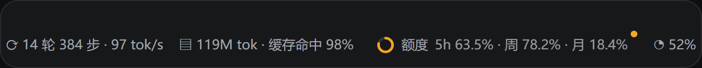

# dsh-usage-plus

[English](README.md) | 中文

独立的 DSH 用量与官方 Plan 额度插件（Host + Web UI）。要求 DSH `>= 0.2.2-rc.3 < 0.3.0`；CLI / 开发环境要求 Node `>= 24.9.0`，不支持更旧的 DSH。可选界面仅在运行中的 DSH 提供相应能力时启用。

[](https://dsh.pub/zh/plugins/dsh-usage-plus/)

## 特性

- 自动复用 DSH 已配置模型的凭据，查询 DeepSeek、Moonshot（国内/国际）、Kimi Coding、Anthropic Claude Pro/Max、GLM Coding Plan（国内/国际）、OpenCode Go、MiniMax（国内/国际）、Codex/ChatGPT、GitHub Copilot、OpenRouter、Vercel AI Gateway、SiliconFlow（国内/国际）、ZenMux 与 NanoGPT 的官方余额/额度。
- 在 `conversation.composer.dock`（与官方轮次 / Token / ContextMeter 同行）显示当前模型的真实 5 小时、每周、每月额度；服务端没有返回官方额度窗口时完全不显示。
- 插件页每个数字都带口径徽标（`全设备` / `账号级` / `本会话`），设备级合计不会被误读成会话级数字。
- 额度条按「每个会话选择的模型」解析：读取该会话 `modelSelection` 投影（composer 模型位 / `/model` 切换立即生效）。尚未产生会话选择时才回退到宿主当前路由；**会话已选中模型时绝不再串到其它会话或全局套餐**。
- 在「插件 → 已安装插件 → dsh-usage-plus」页按“模型配置自动查询 / CPAMC / 火山方舟”分组展示（配置表单位于插件详情页，草稿需点保存）。
- CPAMC 只允许回环地址（或 `cpamcAllowedHosts` 白名单），固定调用只读管理路由并拒绝重定向。
- 火山方舟使用 `VOLC_ACCESSKEY` / `VOLC_SECRETKEY` 对官方 OpenAPI 做 HMAC-SHA256 签名。
- 密钥始终留在 DSH 宿主进程 / 凭据库，不发送到浏览器。
- 保留实时 Token 台账、余额与趋势；概览提供完整 26 周（周一至周日）活动热图；台账默认保留 182 天。
- 插件页与输入框额度条共用一条条件请求轮询：请求不重叠，页面隐藏即暂停。
- 宿主按数据版本缓存概览文档：热轮询不再重新聚合台账，并用缓存 ETag 直接返回 `304`。
- 概览支持 7 / 30 / 90 / 182 天窗口切换，并可从插件页把聚合台账导出为 CSV 或 JSON。
- 首次安装时若台账为空，会从 DSH 会话历史回填既有用量（有界、受保留期限制，写入 `backfill.json` 标记；需要宿主组合挂载 session query 服务）。
- 可选阈值告警：今日已计价消费、套餐窗口百分比、人民币余额过低；页面横幅 + 复用宠物气泡，按可配置冷却时间去重。
- 设置页数据健康卡：台账覆盖与体积、保留期、回填状态、探测新鲜度/失败提供方、保留的损坏文件记录。

## 截图

### 输入框额度条（当前模型）



当前模型命中套餐后，在 composer dock 状态条显示官方 5 小时 / 周 / 月额度的紧凑胶囊，环形标记最紧窗口；点开可看逐窗口进度条、重置时间与来源徽标（如「火山」）。无官方窗口时不渲染。

### 插件 → 已安装插件 → dsh-usage-plus · 概览


概览是一块仪表盘：今日主数字、作为主图的 26 周热力图、账号级额度环与可切换 7 / 30 / 90 / 182 天窗口的提供方排名。所有数字都带口径徽标（`全设备` / `账号级`），余额行只展示真实余额；套餐额度、外部数据源与聚合台账的 CSV / JSON 导出在同页其它标签中。

### 设置 · 数据导出


聚合台账（按日 × 提供方 × 模型合计）可按所选窗口导出为 CSV 或 JSON；文件在本机生成，下载路由仅允许回环地址。

## 安装

按官方方式把本包加入 profile 的 bundle 层（会写入依赖并追加到 `dsh.profile.bundles`，从而应用包内 `cordis.patch.yml`）：

```bash
dsh plugin --profile desktop add github:qxcool/dsh-usage-plus
# 或从本地 checkout：
# dsh plugin --profile desktop add ./
```

GitHub 形式安装的是本仓库已提交的 `lib/` 构建产物；npm 包可能落后于 GitHub 版本，需要最新版时优先用 GitHub 形式。要求 DSH `0.2.2-rc.3` 或更新（低于 `0.3.0`）。

包内已自带 patch（`id: usage-plus`，`name: dsh-usage-plus`）。若 profile 里仍有旧的 `@linxin666/dsh-usage` / `web-ui-usage`，请在 profile 的 `cordis.patch.yml` 中将其 `disabled: true`，避免 UI 重复。

## 提供方覆盖

| 提供方路由 id | 数据来源 | 事实 |
|---|---|---|
| `deepseek` / `deepseek-official` | `api.deepseek.com/user/balance` | 人民币余额 |
| `moonshotai-cn` / `moonshotai` | Moonshot `/v1/users/me/balance` | 人民币 / 美元余额 |
| `kimi-coding` | Kimi For Coding 用量 API | 5 小时 / 周窗口 |
| `anthropic` | Claude Pro/Max OAuth 用量（仅 OAuth） | 5 小时 / 周窗口 |
| `zai`（`zai-coding` 别名）/ `zai-coding-cn` | GLM Coding Plan 监控 API | 套餐窗口 |
| `opencode-go` | OpenCode Go 用量 API | 滚动 / 周 / 月窗口 |
| `minimax-cn` / `minimax` | MiniMax coding-plan remains API | 5 小时 / 周窗口 |
| `openai-codex` | ChatGPT Codex 用量（OAuth） | 5 小时 / 周窗口 |
| `github-copilot` | Copilot premium 额度（OAuth） | 月窗口 |
| `openrouter` | OpenRouter credits API | 美元余额 |
| `vercel-ai-gateway` | Vercel AI Gateway credits API | 美元余额 |
| `siliconflow` / `siliconflow-cn` / `siliconflow-intl` | SiliconFlow 用户信息 | 人民币 / 美元余额 |
| `zenmux` | ZenMux PAYG 余额 API | 美元余额 |
| `nano-gpt`（需手工声明路由） | NanoGPT check-balance API | 美元余额 |

CPAMC 与火山方舟仍作为独立外部数据源在设置页配置。仅 OAuth 的适配器（`anthropic`、`github-copilot`）在 API Key 凭据下会直接跳过而不是报错；没有可验证额度 API 的路由不显示卡片或额度条。

## 外部数据源

普通模型 Provider 不需要重复配置密钥。CPAMC 与火山方舟是可选独立数据源，凭据可写入 DSH 凭据库或宿主环境变量（`CPAMC_MANAGEMENT_KEY`、`VOLC_ACCESSKEY`、`VOLC_SECRETKEY`）。

### CPAMC 配置

CPAMC（CLI Proxy API 管理端）用于读取 CPAMC 中已汇集的 **codex / kimi / claude** 账号额度。插件只读两个管理接口（`GET /v0/management/auth-files`、`POST /v0/management/api-call`），不会写入。

1. 在 DSH 宿主可访问的位置运行 CPAMC：本机为 `http://127.0.0.1:8317`；远程为 HTTPS origin，例如 `https://api.example.com`（不能带路径）。
2. 在 CPAMC 服务端开启 management key（控制台请求头 `x-management-key` 用的那个 key）。
3. 在「插件 → 已安装插件 → dsh-usage-plus → 设置 → 外部额度源」填写：
   - **启用 CPAMC 独立额度源**：打开；
   - **CPAMC 管理地址**：只填 origin（`http://127.0.0.1:8317` 或 `https://api.example.com`）；带 `/v0`、`/v1` 路径或聊天 API 网关地址会被拒绝；
   - **CPAMC 允许的 host**：仅远程需要，逗号分隔域名、不含协议和端口，例如 `api.example.com`；
   - **CPAMC Management Token**：management key，写入 DSH 凭据库（或预先设置 `CPAMC_MANAGEMENT_KEY`），不会回传浏览器。
4. 点击**保存**，再点新增的**测试连接**按钮：它会调用同样的只读管理接口，返回延迟、可读账号数与前几个额度窗口，失败时给出具体修复提示。
5. 也可用命令行验证：
   ```bash
   curl -fsS -H "x-management-key: $CPAMC_MANAGEMENT_KEY" \
     http://127.0.0.1:8317/v0/management/auth-files
   # 远程：
   curl -fsS -H "x-management-key: $CPAMC_MANAGEMENT_KEY" \
     https://api.example.com/v0/management/auth-files
   ```

| 测试结果 | 含义 / 处理 |
|---|---|
| `fetch failed (ECONNREFUSED)` | 该 origin 没有服务监听。启动本机 CPAMC，或把管理地址改成远程 origin 并把域名加入允许 host。 |
| `CPAMC HTTP 401/403` | Management Token 错误，或 CPAMC 服务端未开启 management key。 |
| `CPAMC redirect refused` | origin 发生重定向（常见 http→https 或反代）。直接填写最终 HTTPS origin。 |
| `URL must be a loopback origin …` | 管理地址含路径 / 协议拼写错误 / 主机不在允许 host 列表。 |
| `no quota accounts returned` | CPAMC 连通，但没有带可读额度接口的 codex / kimi / claude 账号。 |

只读取账号级套餐窗口；CPAMC 不提供余额，其它类型账号会被忽略。

## 模型体验（Model Experience）

- 额度条跟随**当前会话**的 `modelSelection`；会话已有路由时不会串用其它会话或全局套餐。
- 仅展示远端 Plan API 返回的真实窗口百分比，不用本地 Token 估算冒充额度。
- Token 台账与余额卡留在 Plugins 页，不注入对话正文。

## 已知限制（Known Limitations）

- 要求 DSH `>= 0.2.2-rc.3 < 0.3.0`；缺少 `configForms`、`plugins.bundle.config` 或 `conversation.composer.dock` 等可选能力时自动跳过对应界面，不影响 DSH 启动。
- 历史回填仅在台账为空且宿主组合挂载 `sessionQuery` 时执行；已有台账不会被重复计数。
- 升级后重新加载的客户端可能短暂运行在旧 Host 进程之上：此时告警字段会隐藏、旧设置仍可保存；重启 DSH 加载新 Host 后，健康信息、告警和新适配器才会生效。
- 告警事件与宠物气泡冷却保存在内存中（DSH 重启会重新开始一个事件）；余额告警只比较人民币余额，日消费告警只统计已计价路由（目前为 DeepSeek 官方价格表）。
- 无官方 Plan API 的提供方不会显示额度条，也不会伪造窗口。
- CPAMC 仅允许回环（或白名单 host）；管理路由只读且拒绝重定向。
- 火山方舟需凭据库 AK/SK（或环境变量）；签名只在 Host 进程执行。
- 悬浮宠物气泡需 profile 中另有 pet 服务；`bubbleMode: off` 可关闭播报。

## 性能（Performance）

- **单条共享轮询。** 插件页与每个输入框额度条共用一次在途概览请求：突发触发合并为一次尾随请求，手动刷新排在进行中的读取之后，页面隐藏即暂停。
- **宿主缓存概览。** 每个数据版本最多重建一次；数据健康的文件系统事实带 2s TTL。热读取直接用缓存 ETag 返回 `304 Not Modified`，不再重新聚合保留期台账。
- **单遍聚合。** 26 周热图由一张预计算的按日表生成；累计窗口跳过页面不渲染的按模型明细。
- **安静、低开销的界面刷新。** 进度条不再动画布局宽度；告警收成单行摘要；重复的卡片口径徽标改为一行口径说明，10s 轮询重绘的装饰更少。

## 开发（Development）

`pnpm typecheck`、`pnpm test`、`pnpm build` 覆盖插件质量门禁。无需登录 DSH Web GUI 即可预览界面：运行 `python scripts/preview/shot.py`，查看 `docs/screenshots/` 下的 PNG；详见 [scripts/preview/README.md](scripts/preview/README.md)。

## 准确性原则

Plan 页面与 composer 额度条只展示远端官方接口真实返回的窗口。没有 Plan API、没有百分比或查询失败时，不用本地 Token 估算冒充额度。

## 致谢与许可

项目基于 `@linxin666/dsh-usage`（Apache-2.0）独立演进；CPAMC 安全边界与火山方舟签名协议参考 `dsh-cost-meter`（MIT）。详见 [LICENSE](LICENSE)。
